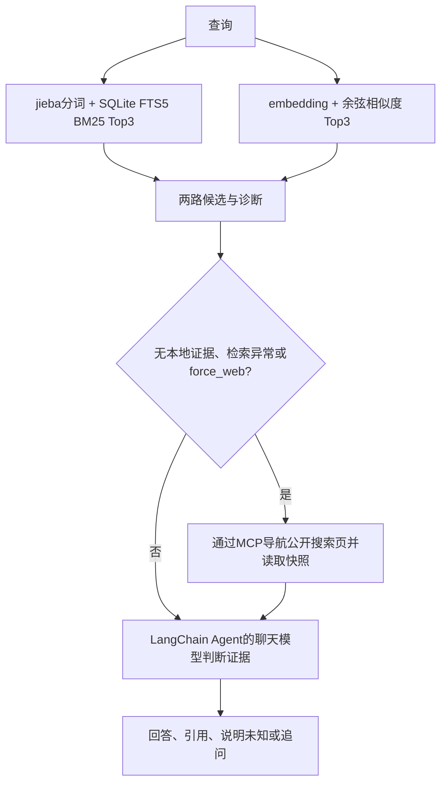

# 混合RAG与浏览器MCP降级

以前 `RAGService.search()` 只做向量检索。`lookup_policy()` 是另一份固定关键词规则库，
从未作为RAG自动降级调用。本次将RAG改为两路并行，固定规则工具仍保留。

## 当前流程



默认每路最多3条，总共最多6个本地候选。同一chunk可能出现在两组里：
`keyword_hits`、`semantic_hits` 保留各自排名；兼容列表 `hits` 会去重，并保留
`retrieval_methods`、`retrieval_scores`、`retrieval_ranks`，不把两次命中算两个独立来源。
关键词BM25分数和余弦分数不能直接比较，也不是答案正确率。

工具返回JSON分组，聊天模型在正常工具调用循环中阅读这些证据。
原版由聊天模型判断两路候选。现在默认接入独立Rerank阶段：配置齐全时调用排序模型，
未配置或失败时使用RRF名次融合。最终TopN进入聊天模型，原始分组留在API供诊断。
参数和启用步骤见[记忆与Rerank](memory-and-rerank.md)。关闭`RAG_RERANK_ENABLED`可恢复原版。
候选不够相关时，模型可以再次调用工具并传 `force_web=true`。这不会关闭原来的两路检索。

## 从哪些代码学起

| 文件 | 学习重点 |
| --- | --- |
| `rag/tokenizer.py` | 中文搜索分词、停用词、FTS查询转义 |
| `rag/sqlite_vector_store.py` | FTS5索引、BM25、旧库迁移、事务内同步关键词索引 |
| `rag/service.py` | 两个任务并行提交、独立捕获异常、候选去重、决定是否走网页 |
| `rag/web_fallback.py` | MCP客户端、stdio/HTTP传输、导航和快照、超时、进程清理 |
| `tools/rag_tool.py` | 同步/异步LangChain工具，将结构化证据交给模型 |
| `skills/knowledge_base_qa/SKILL.md` | 模型如何使用候选、引用来源、处理缺失证据 |
| `tests/test_hybrid_rag.py` | 真正并发、故障保留结果、迁移、MCP协议和模型收到证据的验证 |

`search()`保留原来的列表返回值；`retrieve()`返回分组、`warnings`和`web_attempted`。
API、CLI和客服MCP查询入口已改用完整结果。工具名仍是 `search_knowledge_base`。

## 配置

默认已启用Playwright隔离stdio通道，依赖就绪时不必另填URL。
本次更新 `.env.example`；在现有 `.env` 中可用如下配置调整检索、关闭网页或换HTTP服务器：

```dotenv
RAG_BRANCH_TOP_K=3
RAG_SEMANTIC_MIN_SCORE=0.35
RAG_LOCAL_TIMEOUT_SECONDS=15
RAG_RETRIEVAL_WORKERS=4
RAG_WEB_FALLBACK_ENABLED=true
RAG_WEB_MCP_TRANSPORT=stdio
RAG_WEB_MCP_COMMAND=npx
RAG_WEB_MCP_ARGS='["-y", "@playwright/mcp@0.0.83", "--headless", "--isolated"]'
RAG_WEB_MCP_CACHE_DIR=data/mcp_npm_cache
RAG_WEB_SEARCH_URL=https://www.bing.com/search
RAG_WEB_TIMEOUT_SECONDS=30
RAG_WEB_MAX_CHARS=12000
```

依赖安装：`pip install -e '.[mcp]'`，并准备Node.js和Chrome。
本次在项目环境中安装了jieba，并验证Playwright MCP版本0.0.83。
stdio客户端启动独立无头进程和临时浏览器工作目录，仅继承SDK允许的环境变量；
不会把聊天API密钥传给子进程。npm缓存使用独立项目目录，避免旧的用户缓存权限问题。
首次运行npx可能需要下载包；可先在项目根目录预热：

```bash
npm_config_cache="$PWD/data/mcp_npm_cache" npx -y @playwright/mcp@0.0.83 --version
```

或者先启动独立HTTP服务器：

```bash
npm_config_cache="$PWD/data/mcp_npm_cache" npx -y @playwright/mcp@0.0.83 --headless --isolated --port 8931
```

再将环境配置改为 `RAG_WEB_MCP_TRANSPORT=streamable_http` 和
`RAG_WEB_MCP_URL=http://127.0.0.1:8931/mcp`。该MCP服务须提供
`browser_navigate` 和 `browser_snapshot`，不得开启共享已登录浏览器上下文。
远程服务可填写 `RAG_WEB_MCP_TOKEN`，客户端通过Bearer头传递认证。
本项目的 `mcp_server.py` 是对外提供客服工具的服务器，浏览器降级连接的是另一个MCP服务器。

`RAG_SEMANTIC_MIN_SCORE=0.35` 是起步阈值，需根据实际embedding与评估集校准。
语义检索取 `RAG_MIN_SCORE` 和此阈值中的较大值，不把明显低分候选当作有效证据。
`top_k`现在表示每路数量，并受 `RAG_BRANCH_TOP_K`上限约束，不表示合并列表的总条数。

## 如何测试

```bash
python -m customer_service_agent.cli rag-search "退款规则"
python -m customer_service_agent.cli rag-search "公开快递服务说明" --force-web
python -m pytest tests/test_rag.py tests/test_hybrid_rag.py tests/test_skills.py -q
```

FastAPI示例：`POST /rag/search` 的JSON可使用
`{"query":"公开服务说明","top_k":3,"force_web":true}`。
响应包含三组候选以及去重后的 `hits`；需要检查 `warnings`，不能仅凭HTTP200认为在线查询成功。

没有embedding配置但已有chunk时，关键词仍可搜索；语义路径显示不可用并尝试网页补充。
入库需要真正的embedding；不会生成虚假向量。旧索引会自动补建FTS5关键词索引，不必为此
重新执行会产生费用的 `rag-ingest`。替换索引依然先成功向量化，再事务更新两份索引。

自动测试使用模拟embedding和浏览器MCP替身，不调用收费模型。
其中一项启动真实Python MCP服务并通过stdio完成初始化、工具发现、导航、快照和关闭；
它验证协议链路，不是互联网搜索。另有模拟聊天模型测试验证两路证据确实进入工具调用循环。
已存在的单/多Agent装配入口问题不属于这次RAG修改，完整多Agent测试仍需单独处理。

## 网页结果与降级限制

目前读取公开搜索结果页的快照，不自动逐页打开搜索链接，也不绕过验证码。
来源保存搜索URL、抓取时间和快照中的实际链接；网页分数0仅表示“未打分”。
模型应核对实际链接，网页不能替代本店规则、私人订单、付款或退款记录。
网页内容中的指令不能增加模型权限或触发业务写入。

查询中的常见订单号、运单号、长数字、联系方式和密码等会被拦截，要求模型改成公开主题。
这是一层基础拦截，不是完整DLP；不会自动把聊天历史、客户画像或全部本地chunk传给浏览器。

| 诊断代码 | 含义 |
| --- | --- |
| `keyword_unavailable:...` / `semantic_unavailable:...` | 某路失败，保留其他成功结果 |
| `web_mcp_not_configured` | 没有浏览器启动命令或HTTP地址 |
| `web_mcp_dependency_missing` | 未安装mcp额外依赖 |
| `web_mcp_browser_tools_missing` | 配置的服务不提供需要的浏览器工具 |
| `web_query_requires_public_terms` | 查询含常见私人标识，需改为公开主题 |
| `web_navigation_failed` / `web_snapshot_failed` | 浏览器访问或读取页面失败 |
| `web_verification_required` | 搜索页要求验证真人 |
| `web_timeout` / `web_busy` | 浏览器执行或等待超时 |
| `web_no_evidence` / `web_disabled` | 没有网页证据或配置关闭网页 |

本地两路共用RAG_LOCAL_TIMEOUT_SECONDS等待预算，超时后保留已完成结果并尝试网页。
每个RAGService共用最多RAG_RETRIEVAL_WORKERS个线程，避免每次请求无限增线程。
已经运行的Python线程不能强杀，底层请求仍受embedding客户端超时/重试约束；
服务close会取消尚未执行的任务，已运行任务收尾后退出。
浏览器调用单独受RAG_WEB_TIMEOUT_SECONDS控制。上线大流量还应增加部署级队列和限流。

参考：[SQLite FTS5](https://www.sqlite.org/fts5.html)、
[jieba](https://github.com/fxsjy/jieba)、
[官方MCP Python SDK](https://github.com/modelcontextprotocol/python-sdk)、
[Playwright MCP](https://github.com/microsoft/playwright-mcp)。

## 本次验证记录

2026-10-14：RAG、技能及相关API测试39项通过，代码规范检查通过。
新增长链路测试29项；完整测试从修改前47通过、24失败，变为76通过、24失败。
24项失败是已有的单/多Agent装配和上下文接口不一致，未新增失败案例。

另通过真实Playwright MCP 0.0.83在独立无头Chrome中搜索公开SQLite FTS5文档，
成功取得11148字符的搜索结果页快照，浏览器MCP返回无错误诊断。
未执行收费聊天或embedding调用。数据库迁移只补建关键词索引，原向量无需重算。
