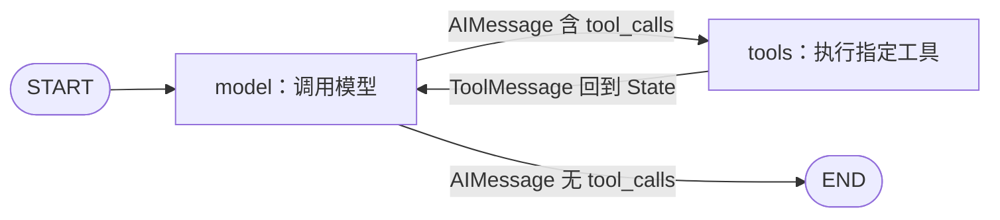

# 从这个客服项目学 LangGraph

你在 `agent.py` 中看不到显式 State 和流程编排，是因为 `create_agent()` 已经替你做完了建图。
它返回的是编译完成的 LangGraph。先看清这层封装，再读本次新增的显式教学图。

## 原项目的图藏在哪里

入口是 [agent.py:134](/Users/jiaqihong/Desktop/python/codex_agent1/src/customer_service_agent/agent.py:134)：

```python
self.graph = create_agent(
    model=llm,
    tools=tools,
    checkpointer=checkpointer.saver,
    context_schema=AgentContext,
    middleware=[...],
)
```

当前安装的 LangChain 内部创建 `StateGraph`，注册 model/tools 节点、连接边，再 compile。
本项目单 Agent 的主要执行路线是：



条件路由读取模型已经返回的 `tool_calls`，并不额外调用一次模型来判断走哪条边。
订单查询、RAG、画像保存和 Skill 加载是 tools 节点中的可调用工具，不是该图的四个独立节点。

## State 在哪里

因为调用 `create_agent` 时没有传 `state_schema`，框架使用默认 `AgentState`。
下面只摘出本项目使用的核心字段：

```python
class AgentState(TypedDict):
    messages: Annotated[list[AnyMessage], add_messages]
```

State 是各节点读取和更新的数据；`state_schema` 声明它有哪些字段以及怎样合并更新。
它不是模型隐藏的思考过程，也不是整个应用的所有数据库。运行时你可以直接看到它：

```python
config = {"configurable": {"thread_id": "learning-chat"}}
snapshot = agent.graph.get_state(config)
print(snapshot.values)  # 数据，例如 {"messages": [...]}
print(snapshot.next)    # 接下来等待运行的节点
```

对于一个此前不存在的 thread，状态可能是空的。示例脚本会先执行请求，再展示这些字段。

订单查询的消息变化如下；这里的序号表示执行阶段，不是固定 checkpoint 编号：

| 阶段 | 节点写入的更新 | 合并后的 messages |
| --- | --- | --- |
| 输入问题 | HumanMessage | [用户问题] |
| 第一次 model | 带 tool_calls 的 AIMessage | [用户问题, 工具调用请求] |
| tools | 带 tool_call_id 的 ToolMessage | [用户问题, 工具调用请求, 工具结果] |
| 第二次 model | 最终 AIMessage | [用户问题, 工具调用请求, 工具结果, 最终回答] |

第一次 model 返回的 AIMessage 可以没有自然语言正文；是否含 tool_calls 才决定是否执行工具。
ToolMessage 的 tool_call_id 把结果关联到前面的工具调用。

## 为什么只返回一条新消息，不会丢掉整个历史

节点通常返回增量，例如：

```python
return {"messages": [response]}
```

LangGraph 用字段的 reducer 把增量合并到旧 State。messages 使用 `add_messages`：
新消息 ID 会追加，已有 ID 会更新，还能处理 RemoveMessage。它不是简单的列表拼接。
因此输入新用户消息也可以只传这一条：

```python
graph.invoke({"messages": [("user", "再查一下物流")]}, config=config, context=context)
```

同一 checkpointer、同一 thread_id 下，旧 State 会先被恢复，新消息再被合入。
换 thread_id 会选择另一条逻辑会话；这里的 thread 不是操作系统线程。
没有配置持久化时，不能期待两次独立调用自动保留上下文。

没有声明 reducer 的普通字段采用覆盖更新。教学例子中 model_calls 是普通字段，
节点自己计算 `旧值 + 1` 并写回。它累计的是该线程的模型调用次数，跨轮次会继续增长。

## 区分 State、Context、Config 和存储

| 代码中的东西 | 在本项目中的职责 |
| --- | --- |
| State.messages | 随图执行变化的消息与工具结果 |
| context=AgentContext(user_id=...) | 本次运行注入的用户信息 |
| config.configurable.thread_id | 定位会话 checkpoint 的逻辑 ID |
| config.recursion_limit | 限制图执行的 superstep 数量 |
| SqliteSaver | 保存 State 以及运行进度 |
| CustomerProfileRepository | 项目自行维护的跨会话客户画像 |

尤其注意：`context_schema=AgentContext` 定义的是运行上下文，**不是 State schema**。
context 不会自动写成 State 字段或由 checkpoint 自动恢复，每次运行/恢复仍应提供需要的 context。
运行上下文注入也不等同于用户身份认证。

recursion_limit 不表示用户可以聊多少轮，也不是精确的工具调用次数。一个 superstep
可能并行执行多个任务。未达到结束条件且超出限制，会抛出 GraphRecursionError。

## 图内与图外：原代码里两个容易误解的位置

原项目 `ask` 的关系是：

```text
获取会话锁
  → compactor 读取/必要时更新图状态
  → graph.invoke：开始 model/tools 循环
  → 从最终 State 提取答复和工具轨迹
```

历史压缩位于 graph.invoke 之前，不是图内的一个节点；它调用 get_state/update_state，
把旧消息替换成累计摘要和近期消息。摘要作为 SystemMessage 真正写进了 State。

动态画像提示词则不同：[动态 prompt 中间件](/Users/jiaqihong/Desktop/python/codex_agent1/src/customer_service_agent/agent.py:86)
会在每次模型调用前读数据库，再拼接本次模型输入的系统消息。这一拼接不会默认写回 messages。
所以“模型看到的所有内容”与“State.messages 中保存的所有内容”不完全相同。
本项目的 dynamic_prompt 是 wrap_model_call 中间件，没有额外生成一个 profile 节点。

## 编排能力体现在什么地方

在显式图中，节点负责计算，边规定允许的执行路线，条件边根据当前状态选择路线。
LangGraph 统一应用状态更新、调度后续节点，并在配置 checkpointer 时保存步骤快照。
因此你能查看状态、增加审核关卡、组织并行分支，以及在有持久化的前提下暂停并恢复流程。

checkpoint 并非只在最终答复后保存一次。`get_state_history(config)` 能看到多个步骤快照。
它也不保证外部业务写入只发生一次：网络请求、支付或工单写入仍需独立的幂等设计。

现在继续下面的实验，把这些概念变成可观察的输出。

## 动手：先观察原图，再读显式图

本次新增 `examples/langgraph_walkthrough.py`。它复用项目订单工具，订单来自内置演示库；
模型使用本地规则模拟器，不具备真实语言理解能力。LangGraph 调度、消息合并、工具执行和
SQLite checkpoint 都真实运行。不读取 `.env`，数据路径全部指向临时目录，退出后自动清理。
本例不是现有 Agent 的完整替代：没有复制业务中间件、会话互斥、历史压缩和全部工具语义。

在项目根目录和已有 `my_demo1` 环境中运行：

```bash
cd /Users/jiaqihong/Desktop/python/codex_agent1
conda activate my_demo1
PYTHONPATH=src python -m examples.langgraph_walkthrough --mode original
```

这一段真正调用现有 `build_customer_service_agent`，仅注入离线模型和订单工具。
为观察底层执行，示例直接运行 `agent.graph.stream`，没有经过 `agent.ask` 的业务包装。
所以这段学习代码不能直接当作 HTTP 服务的并发入口。

输出里交替出现：

- `updates`：这一节点返回的更新，如 `{"model": {"messages": [AIMessage(...)]}}`。
- `values`：更新应用到各字段 reducer 后的完整 State。
- `snapshot.values`：这条线程已保存的数据。
- `snapshot.next`：等待运行的节点；完成时为 `()`，示例 JSON 显示为 `[]`。

这两种 stream 事件来自同一次执行。不要为了分别看结果而先 `invoke` 再 `stream` 同一请求，
那样会执行两次，写工具可能产生重复副作用。

### 显式图的阅读顺序

1. `LearningState`：本例明确写出 `messages`、`model_calls`、`approved` 三个字段。
2. `call_model`：读取历史，返回新消息和模型调用计数。
3. `after_model`：检查 `AIMessage.tool_calls`，选择进入工具流程还是结束。
4. `StateGraph` 到 `compile`：逐行看节点注册和边的连接。
5. `trace`：观察 `updates`、`values` 和 `get_state`。
6. `review` 和 `run_explicit`：最后再学暂停、持久化和恢复。

`TypedDict` 是字段声明，不负责运行时严格业务校验；业务参数校验仍由项目的 Pydantic Schema 负责。
`NotRequired[int]` 表示输入可以省略这个字段，不会自动提供默认值，所以节点要用
`state.get("model_calls", 0)`。`Annotated[..., add_messages]` 则告诉 LangGraph 如何合并该字段。

### 四个可复现实验

**实验一：工具循环。** 运行上面的 `--mode original`。你应看到 `model → tools → model`，
最终消息类型依次为 `human / ai / tool / ai`。第一次 AIMessage 的正文可以为空，
但 `tool_calls` 非空，因此流程会继续。

**实验二：暂停并恢复。**

```bash
PYTHONPATH=src python -m examples.langgraph_walkthrough --mode explicit
```

本例增加了教学用 `review` 节点，第一次执行到 `interrupt()` 时暂停，`next` 是 `review`。
脚本随后关闭 SQLite 连接、重新构图，再用同一个 `thread_id` 和 `Command(resume=True)` 继续。
终端会明确标出由脚本模拟审批。这是同一进程内重建图后的持久化验证，不是一个人工审批 UI。

恢复调用还会再次传入 `AgentContext`：运行上下文不会因为 checkpoint 自动补回来。
`interrupt` 恢复时，节点从开头重新执行，恢复值成为该次 `interrupt()` 的返回值。
所以节点在 interrupt 前不应执行不可重复的写操作。

**实验三：拒绝执行。**

```bash
PYTHONPATH=src python -m examples.langgraph_walkthrough --mode explicit --decision reject
```

这次路由是 `model → review → model → END`，不会进入 `tools` 节点。
`review` 会补一条对应 tool_call_id 的拒绝 ToolMessage，让模型读到拒绝结果后完成回答。
测试也用计数器断言真实工具未执行，不能只通过“回答说没有执行”来判断。

**实验四：无需工具的分支。**

```bash
PYTHONPATH=src python -m examples.langgraph_walkthrough --mode explicit --message 你好
```

你应看到 `model → END`，`model_calls` 为 1，没有审批，也没有工具调用。
这是本地假模型的固定规则，目的是稳定展示图的不同路线。

### 再做三个小修改检验理解

- 在 `call_model` 设置断点：第一次有几条消息？工具返回后有几条？输入模型的 system 消息是否出现在 State 中？
- 将 `messages` 暂时改为不带 reducer 的 `list[AnyMessage]`：观察节点更新怎样覆盖历史，然后还原。
- 保持同一个 checkpointer，分别使用相同和不同的 `thread_id`：比较消息历史是否共享。

当前测试 `test_langgraph_walkthrough.py` 验证批准与拒绝、SQLite 恢复、会话隔离、第二轮消息保留，
以及相同消息 ID 的替换行为。这些测试证明编排机制，不评估模型理解能力。

## 项目已有的多 Agent 代码，可作为下一阶段对照

`multi_agent/state.py` 的 `WorkflowState` 已明确声明 messages、plan、results、ready 等字段；
`workflow.py` 的 `compile` 则注册 plan、schedule、专业 Agent 和 summarize。
`_dispatch` 用 `Send` 按就绪任务分发，`merge_results` 将不同 task_id 的结果合并。
它展示了单 Agent 的工具循环之外，LangGraph 还能组织动态并行、依赖执行和结果汇合。

需要区分两张图：LangGraph 的执行图，以及 `plan` 数据里记录的业务任务依赖图。
`schedule` 根据业务依赖决定本批次哪些任务可执行，LangGraph 负责实际派发和合并状态。
当前实现按 superstep 批次推进，不是每个任务一结束就立即运行其任意后继。

截至本次检查（2026-09-23），这一模块与公共入口有两处明确的不一致：

- `build_customer_service_agent` 尚不接受多 Agent 测试传入的 `specialist_tools`，也没有按模式分流。
- `AgentContext` 仅定义 `user_id`，但多 Agent 服务/worker 还使用 `session_id`、`request_id`、
  `confirm_action` 和 `task_id`。

因此本教程将它作为代码结构对照，不声称当前 multi 入口已跑通。本次新增示例与这些未接齐的接口无关。
另外，现有的计划格式修复、worker 重试都不是运行期重规划；`confirm_action=False` 返回 blocked
也不等同于教学示例中的 `interrupt` 暂停。

## 对照官方资料

示例按本地 LangChain 1.3.12、LangGraph 1.2.5 验证，使用该环境支持的 `stream` 接口。
线上文档可能同时出现更新的流式 API，学习时先以本例和本地版本为准。

- [Graph API：State、Reducer、Node、Edge](https://docs.langchain.com/oss/python/langgraph/graph-api)
- [Persistence：thread 与 checkpoint](https://docs.langchain.com/oss/python/langgraph/persistence)
- [Streaming：updates 与 values](https://docs.langchain.com/oss/python/langgraph/streaming)
- [Interrupts：暂停与 Command 恢复](https://docs.langchain.com/oss/python/langgraph/interrupts)
