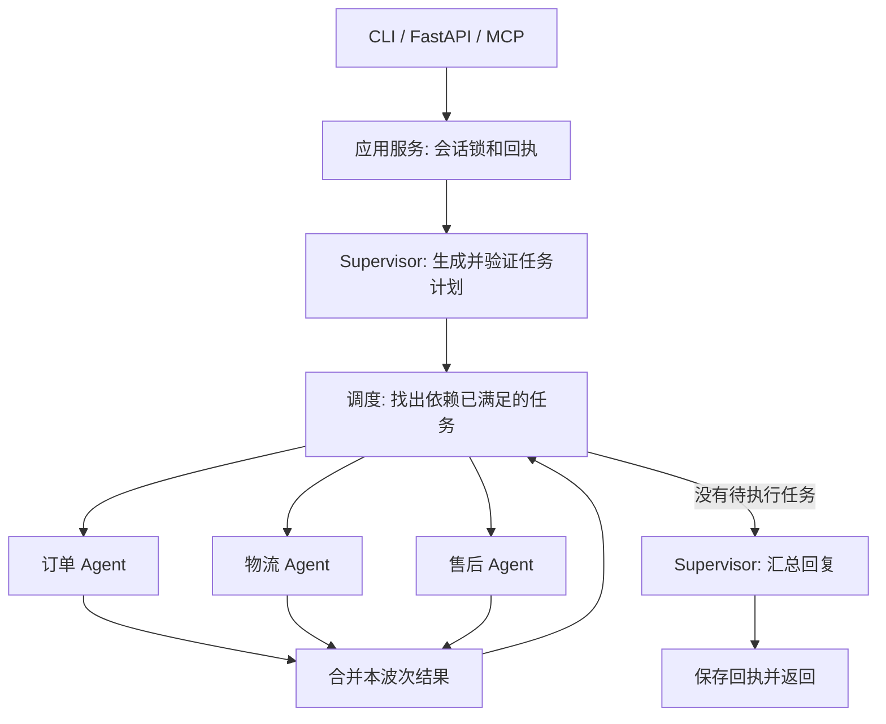

# 从单 Agent 读到协作系统

你已经读过旧版代码，所以先保留那个认识：模型决定调用工具，工具返回事实，记忆保留上下文。
新版在这层之上增加 Supervisor 和任务图。三个专业 Agent 内部仍是你熟悉的 `create_agent()`。

## 先运行

原来的 `.env` 中 CHAT/EMBEDDING 配置继续使用，无需申请新的模型。
新版默认 `AGENT_MODE=multi`，可在 `.env` 中显式加入。不要用 `.env.example` 覆盖已有密钥。

```bash
cd /Users/jiaqihong/Desktop/python/codex_agent1
conda activate my_demo1
python -m pip install -e ".[dev]"
python -m pytest -q
python -m customer_service_agent.cli ask "查询 ORDER-1001 的订单和物流，并说明退货条件" --session multi-demo --user student --trace
```

`--trace` 展示任务分工、状态、重试次数和工具轨迹。每次真实聊天都会调用你配置的模型，
可能有多次模型请求；测试只使用假模型，完全离线。

新图使用 `data/multi_agent_checkpoints.sqlite3`，旧图的聊天记录仍在原来的 MEMORY_DB_PATH，
不自动迁移。客户画像、RAG 索引和工单继续共享。设置 `AGENT_MODE=single` 可对照旧版。

## 运行路径



图中分支表示可选派发，不表示每次都执行全部 Agent。
LangGraph 按 superstep 同步推进：同一波次的并行任务结束后，再调度下一波次。
例如订单查询和政策查询可并行；物流查询依赖订单；退款评估依赖订单、物流和政策。

## 按这个顺序阅读

| 文件 | 新增知识 | 阅读时关注的问题 |
| --- | --- | --- |
| `multi_agent/state.py` | 任务 schema、DAG 校验、reducer | 如何防止未知依赖、循环和结果覆盖？ |
| `multi_agent/prompts.py` | Supervisor 的规划和汇总职责 | 为什么模型提出计划后还要由程序校验？ |
| `multi_agent/specialists.py` | 专业分工和工具权限 | 为什么查询任务没有退款申请工具？ |
| `multi_agent/workflow.py` | StateGraph、Send、并发、重试、结果汇总 | 成功/失败任务怎样决定后续任务能否运行？ |
| `multi_agent/service.py` | 同步/异步入口、会话锁、恢复 | 为什么同会话的用户请求要串行？ |
| `multi_agent/request_store.py` | 请求幂等和持久回执 | request_id 和 thread_id 有什么不同？ |
| `infrastructure/async_runner.py` | asyncio 资源生命周期 | 为什么 CLI 和 FastAPI 可以复用同一个异步服务？ |
| `tools/logistics_tool.py` | 外部系统适配边界 | 如何把演示仓库换成物流公司接口？ |
| `tools/after_sales_tool.py` | 确认、数据库事务和唯一约束 | 为什么防重复不能仅依靠提示词？ |

原来的 `agent.py` 保留单 Agent 实现，末尾工厂根据 `agent_mode` 选择新旧应用服务。
原来的 RAG、模型构建、Skills 加载器和客户画像仓库继续使用。

## 状态和记忆

- `session_id` 对应父图的 `thread_id`，表示会话。
- `request_id` 表示一次用户请求。相同请求重试要用相同 ID；新问题或新确认要换 ID。
- `task_id` 只在本次计划中标识子任务。任务结果每轮重置，不把上一轮结果误用于本轮。
- 父图保存用户对话、计划、结果和执行位置。子 Agent 的工具对话只属于当前任务。
- 最近 N 轮和旧摘要仍由 `ConversationCompactor` 管理；重要资料由订单 Agent 的画像工具保存。
- `AsyncSqliteSaver` 保存协作图 checkpoint，`workflow_requests` 保存最终回执，两者职责不同。
- 已完成请求重试返回原回执；中断请求使用原正文、原确认参数和原 ID，继续尚未完成的任务。
- 任务失败并返回完整/部分回复后，该请求已结束；再次尝试查询需要一个新 request_id。
- 清空聊天会删除图状态并取消未完成请求，但保留已完成回执与业务申请，避免旧写请求再次执行。

同一会话首次使用的 user_id 会固定下来，后续不能换成另一用户。这是隔离检查，不是身份认证。
对公网开放前，user_id 必须由登录系统注入。演示订单没有真实的用户归属校验。

最近 N 轮限制的是当前上下文，不代表 SQLite 中的历史 checkpoint 和回执也自动删除。
正式运行需要另行制定存储保留和清理策略。

## 并发与异常

`MULTI_AGENT_MAX_CONCURRENCY` 限制整个进程中同时运行的 Supervisor/专业 Agent/摘要调用。
不同会话可以并发，同会话依次处理；同会话中的独立任务可并发。
每个专业任务有单次超时和重试上限，网络类错误可以重试，输入校验错误不重试。
失败任务变为结构化结果，依赖它的任务标记 blocked，独立成功结果仍交给 Supervisor。
Supervisor 计划最多修正一次，最多 6 个任务，避免无限分派；汇总失败时直接返回已有结果。

LangGraph 取消异步任务不能撤销已经发往外部系统的写请求，线程中的同步操作也可能继续收尾。
因此数据库唯一约束和业务系统幂等键仍不可少。当前售后申请和新版工单都演示了这个边界。

## 模拟售后申请

当前订单、物流都是演示数据。申请只写入本地 SQLite，不连接真实支付，也不承诺审核成功。

```bash
python -m customer_service_agent.cli ask "确认对 ORDER-1001 提交退货申请，原因是商品不合适" --session after-sales-demo --user student --request-id apply-demo-001 --confirm-action --trace
```

重复完全相同的命令会返回同一请求回执。同一用户、同一订单、同一类型已有待处理申请时，
即使换了 request_id，数据库也会返回原申请编号。
`--confirm-action` 只作用于这一次 `ask`；多轮 `chat` 和 MCP 默认用于查询，不开放确认写操作。

未确认时，调度层阻止 action，工具层也再次检查确认状态。
确认参数来自调用方，生产前应进一步实现绑定具体订单、类型和金额的审核流程。
普通查询任务即使模型尝试调用写工具，也没有对应工具权限。

## FastAPI

```bash
python -m customer_service_agent.cli serve
```

访问 `http://127.0.0.1:8000/docs`，在 `POST /chat` 传入：

```json
{
  "message": "查询 ORDER-1001 的物流及退款条件",
  "session_id": "api-demo",
  "user_id": "student",
  "request_id": "query-demo-001",
  "confirm_action": false
}
```

回复保留 `answer`，并新增 `mode`、`request_id`、`status`、`tasks`。
`status` 为 completed、partial 或 failed；任务状态为 success、failed 或 blocked。
任务 success 表示任务执行成功，不意味着退款获批。API 不返回内部工具轨迹。
省略 request_id 时，响应头 X-Request-ID 与生成的业务请求 ID 一致，失败后也可用于重试。
同一 ID 更换正文或确认参数返回 409；同一会话更换用户返回 403。

本版本仅支持单进程运行一个协作服务实例，不要设置多个 uvicorn workers。
跨进程需要数据库租约/队列等会话调度，单纯改成 PostgreSQL 并不会自动解决并发写同一会话。

## 验证重点

- `test_multi_agent.py`：并发及依赖、超时、重试、错误计划、请求重放、重启恢复、记忆隔离与压缩。
- `test_multi_agent_tools.py`：真实 LangChain 工具循环、物流、确认和权限、防重复申请、客户画像。
- `test_multi_agent_api.py`：HTTP 契约、请求回执、部分失败与用户隔离。

这些测试验证工程机制，不代表已经验证你的真实模型一定能正确规划所有业务问题。
下一步学习可固定一批真实客服问题，比较 single/multi 的准确率、耗时和模型调用成本。
